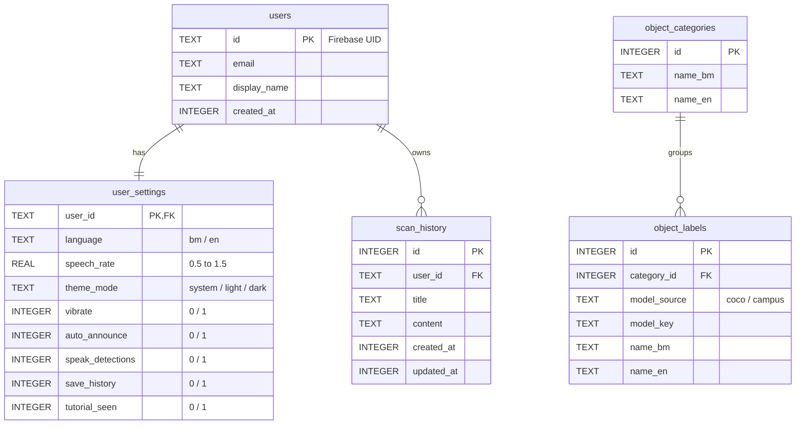

# IrisVision Database Design (Increment 3, Step 3)

IrisVision stores its data in a local SQLite database (`irisvision.db`) on the phone, using the `sqflite` package. Firebase Authentication is used for login only. Scanned text never leaves the device.

## 1. Entity Relationship Diagram

## 2. Data Dictionary

| Table | Column | Type | Key / Rule | Description |
|---|---|---|---|---|
| users | id | TEXT | PK | Firebase UID of the account |
| users | email | TEXT | NOT NULL | Account email |
| users | display_name | TEXT | | Name shown in Profile |
| users | created_at | INTEGER | NOT NULL | First sign-in on this phone (epoch ms) |
| user_settings | user_id | TEXT | PK, FK → users.id, ON DELETE CASCADE | One settings row per user |
| user_settings | language | TEXT | CHECK bm/en | App and voice language |
| user_settings | speech_rate | REAL | CHECK 0.5–1.5 | Voice speed |
| user_settings | theme_mode | TEXT | CHECK system/light/dark | Display theme |
| user_settings | vibrate | INTEGER | CHECK 0/1 | Vibrate when an object is found |
| user_settings | auto_announce | INTEGER | CHECK 0/1 | Say screen name when opened |
| user_settings | speak_detections | INTEGER | CHECK 0/1 | Say detected objects |
| user_settings | save_history | INTEGER | CHECK 0/1 | Save scanned text to History |
| user_settings | tutorial_seen | INTEGER | CHECK 0/1 | First-time guide already shown (added in schema version 2) |
| scan_history | id | INTEGER | PK, AUTOINCREMENT | Scan record ID |
| scan_history | user_id | TEXT | FK → users.id, ON DELETE CASCADE | Owner of the record |
| scan_history | title | TEXT | NOT NULL | Auto title (first ~40 characters), can be renamed |
| scan_history | content | TEXT | NOT NULL | Scanned text, paragraphs separated by a blank line |
| scan_history | created_at | INTEGER | NOT NULL | Time scanned (epoch ms) |
| scan_history | updated_at | INTEGER | NOT NULL | Time last renamed (epoch ms) |
| object_categories | id | INTEGER | PK | Category ID (12 COCO supercategories + Campus) |
| object_categories | name_bm / name_en | TEXT | NOT NULL | Category name in BM and English |
| object_labels | id | INTEGER | PK, AUTOINCREMENT | Label ID |
| object_labels | category_id | INTEGER | FK → object_categories.id | Category of the object |
| object_labels | model_source | TEXT | CHECK coco/campus, UNIQUE with model_key | Which model the label belongs to |
| object_labels | model_key | TEXT | NOT NULL | Class name output by the model, e.g. `cell phone` |
| object_labels | name_bm / name_en | TEXT | NOT NULL | Name shown and spoken, e.g. Telefon / Phone |

Schema version 2 added `tutorial_seen`. Phones that already have version 1 are upgraded with `ALTER TABLE user_settings ADD COLUMN`, so existing settings and history are kept.

Seed data: 13 categories, 80 COCO labels and 10 campus labels (from `campus_labels.txt`) are inserted when the database is first created.

## 3. Normalisation (3NF)

**1NF.** Every column holds one atomic value and every table has a primary key. Settings are separate columns rather than one text blob, and BM and English names are separate columns.

**2NF.** Every table has a single-column primary key, so no column can depend on only part of a key. `object_labels` uses a surrogate key `id`, with `(model_source, model_key)` kept as a UNIQUE candidate key.

**3NF.** No non-key column depends on another non-key column:
- User details (email, name) live only in `users`. `scan_history` and `user_settings` store just `user_id`.
- Category names live only in `object_categories`. `object_labels` stores just `category_id`, so renaming a category changes one row.
- Settings were moved out of `users` into `user_settings`, because they describe app preferences, not the person.
- Derived values such as word count and paragraph count are calculated from `content` when needed, not stored.

## 4. CRUD and Authorisation

| Operation | Where in the app | SQL |
|---|---|---|
| Create | Scan Text: every successful scan is saved (if Save history is on) | `INSERT INTO scan_history` |
| Read | History screen list; tap a record to hear it again | `SELECT ... WHERE user_id = ? ORDER BY created_at DESC` |
| Update | History: Rename button | `UPDATE scan_history SET title = ?, updated_at = ? WHERE id = ? AND user_id = ?` |
| Delete | History: Delete button and Delete all | `DELETE FROM scan_history WHERE id = ? AND user_id = ?` |
| Create/Update | Profile: any setting change is saved right away | `INSERT OR REPLACE INTO user_settings` |
| Delete | Profile: Delete account (after password or Google re-check, and after Firebase deletes the account) | `DELETE FROM users WHERE id = ?` (CASCADE removes settings and history) |

Authentication is handled by Firebase. Authorisation is enforced in the database layer: every History query filters by the signed-in user's Firebase UID, so a user can only see, rename or delete their own records, even when several accounts sign in on the same phone.

`users` is never written with `INSERT OR REPLACE`, because REPLACE deletes the old row first and ON DELETE CASCADE would wipe that user's settings and history. It uses `INSERT OR IGNORE` followed by `UPDATE`.

## 5. Code Location

| File | Role |
|---|---|
| `lib/services/database_service.dart` | Opens the database, creates tables, seeds labels, all queries |
| `lib/services/app_settings.dart` | Loads settings after login and saves every change |
| `lib/views/auth_gate.dart` | Registers the user and loads settings before Home opens |
| `lib/views/history/history_view.dart` | History screen (Read, Update, Delete) |
| `lib/views/scan/scan_text_view.dart` | Saves each scan (Create) |
| `lib/views/live_detection_view.dart` | Gets BM/EN object names from `object_labels` |
